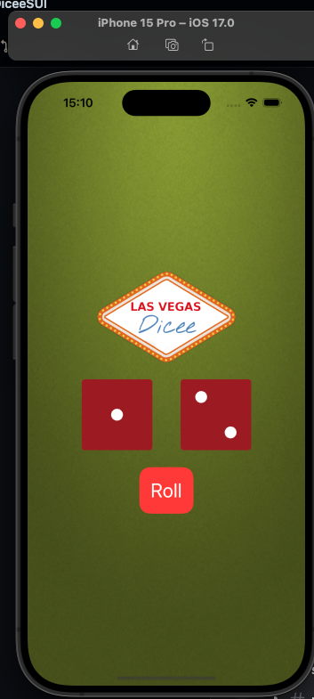

[Русский](README.md) | **English**

# Dicee

Two six-sided dice. The Roll button throws both at once.



## What it does

A green screen shows two dice and a logo. Each face is its own image. Roll gives each die a new face.

The model keeps the face image names. The view model picks two at random, and the screen shows them.

## Course

A sample from [GeraldCO/DiceeSUI](https://github.com/GeraldCO/DiceeSUI). The dice app was written by Gerald.

## Stack

SwiftUI, MVVM.

## Run

```bash
git clone https://github.com/dpogonia/Dicee-GERALD.git
cd Dicee-GERALD
open DiceeSUI.xcodeproj
```

Run the **DiceeSUI** scheme on an iPhone simulator. The deployment target is iOS 17.

## Author

[Dmitrii Pogonia](https://github.com/dpogonia)
