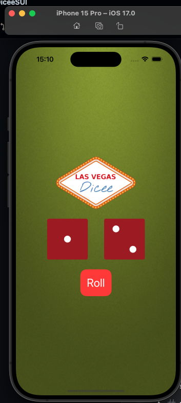

**Русский** | [English](README.en.md)

# Dicee

Две шестигранные кости. Кнопка Roll бросает обе сразу.



## Что умеет приложение

На зелёном поле два кубика и логотип. У каждой грани своя картинка. Roll показывает новую грань у каждого кубика.

Модель хранит имена картинок. ViewModel выбирает две случайные грани, экран их показывает.

## Курс

Пример [GeraldCO/DiceeSUI](https://github.com/GeraldCO/DiceeSUI). Кости написал Gerald.

## Стек

SwiftUI, MVVM.

## Запуск

```bash
git clone https://github.com/dpogonia/Dicee-Gerald.git
cd Dicee-Gerald
open DiceeSUI.xcodeproj
```

Запустите схему **DiceeSUI** на симуляторе iPhone. Цель сборки — iOS 17.

## Автор

[Dmitrii Pogonia](https://github.com/dpogonia)
